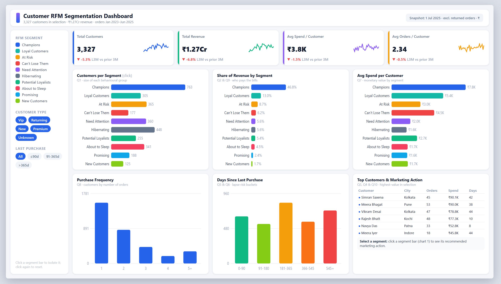

# 🛒 Customer Segmentation & RFM Analysis

Customer Segmentation & RFM Analysis using **Python, SQL, and Business Analytics** to understand customer purchasing behavior, identify valuable customer groups, and support targeted marketing and retention decisions.

---

## 📊 Project Overview

This project analyzes e-commerce customer transaction data to understand purchasing behavior and identify customers based on their **value, engagement, and purchase activity**.

The project uses **RFM (Recency, Frequency, Monetary) Analysis** to segment customers into meaningful groups such as:

- 👑 Champions
- 💎 Loyal Customers
- 🌱 Potential Loyalists
- 🆕 New Customers
- ⚠️ At Risk
- 💤 Hibernating Customers
- 🚨 Lost Customers

**Python (Pandas)** is used for data cleaning, preparation, RFM calculation, and customer segmentation.

**SQL** is used for business-focused customer analysis and KPI calculations.

A **Web-Based Interactive Analytics Dashboard** is used to present customer segments, KPIs, revenue contribution, purchasing behavior, and business insights.

---

## 🎯 Business Objective

The main objectives of this project are to:

- Identify high-value and loyal customers.
- Understand customer purchasing behavior.
- Segment customers using RFM analysis.
- Identify customers at risk of becoming inactive.
- Analyze revenue contribution across customer segments.
- Understand differences in customer spending and purchase frequency.
- Support targeted marketing and retention strategies.
- Help businesses prioritize customers based on value and engagement.

---

## 📁 Dataset

The project uses customer transaction data containing information related to:

- Customer details
- Customer type
- Order information
- Order dates
- Product information
- Quantity
- Unit price
- Discount
- Revenue
- Payment information
- Order status

The transaction-level data is cleaned and validated before being used for RFM analysis and customer segmentation.

---

## ❓ Business Questions

The analysis focuses on the following business questions:

1. How many customers belong to each RFM segment?
2. Which customer segments generate the most revenue?
3. Who are the highest-value customers?
4. Which customers are highly engaged and loyal?
5. Which customers are at risk of becoming inactive?
6. Which customers have not purchased recently?
7. What is the average customer value by segment?
8. How frequently do customers purchase?
9. Which segments contribute the largest share of total revenue?
10. How can marketing strategies be customized for different customer segments?

---

# 🔄 Project Workflow

The project follows a structured end-to-end **Data Analyst workflow**:

```text
1. Understand Business Problem
          ↓
2. Inspect Raw Dataset
          ↓
3. Perform Data Quality Audit
          ↓
4. Clean Data using Pandas
          ↓
5. Validate Cleaned Data
          ↓
6. Explore Customer Purchasing Patterns
          ↓
7. Calculate RFM Metrics
          ↓
8. Create Customer Segments
          ↓
9. Perform SQL Business Analysis
          ↓
10. Define KPIs
          ↓
11. Build Interactive Dashboard
          ↓
12. Generate Business Insights
          ↓
13. Recommend Marketing & Retention Actions
````

---

# 1️⃣ Understand Business Problem

The first step was to translate the business requirement into analytical questions.

Key objectives included:

* Understanding customer purchasing behavior.
* Identifying differences in customer value.
* Finding high-value and loyal customers.
* Identifying customers with declining engagement.
* Determining how RFM analysis can support marketing and retention decisions.

---

# 2️⃣ Inspect Raw Dataset

The raw transaction dataset was inspected using **Python (Pandas)** to understand its structure and initial data quality.

Key activities included:

* Loading the raw dataset.
* Checking the number of rows and columns.
* Reviewing column names and data types.
* Inspecting sample customer and transaction records.
* Checking missing values.
* Checking duplicate records.
* Reviewing dates, quantities, prices, discounts, and revenue.
* Examining customer and transaction patterns.

---

# 3️⃣ Perform Data Quality Audit

A data quality audit was performed using **Pandas** before conducting RFM analysis.

The audit focused on:

* Missing values.
* Duplicate rows and transactions.
* Missing or invalid Customer IDs.
* Invalid or inconsistent transaction dates.
* Negative or zero quantities.
* Invalid or negative prices and revenue values.
* Inconsistent text casing and whitespace.
* Incorrect data types.
* Missing or inconsistent customer information.
* Duplicate or conflicting Order IDs.

This step ensured that data quality issues were identified before customer-level analysis.

---

# 4️⃣ Clean Data using Pandas

Data cleaning and preprocessing were performed using **Python (Pandas)**.

Key activities included:

* Removing exact duplicate records.
* Handling missing customer information.
* Standardizing customer and transaction identifiers.
* Standardizing text values, casing, and whitespace.
* Converting transaction dates into a consistent date format.
* Converting quantity, price, discount, and revenue into numeric data types.
* Correcting invalid or negative age values.
* Handling invalid quantities and transaction amounts.
* Recalculating missing revenue where sufficient transaction data was available.
* Removing invalid transaction records from the RFM dataset.
* Investigating duplicate and conflicting Order IDs.
* Preparing the cleaned transaction data for RFM analysis and SQL analysis.

> 🧹 Clean transaction data is essential for reliable customer segmentation and business analysis.

---

# 5️⃣ Validate Cleaned Data

The cleaned dataset was validated using **Python (Pandas)** before calculating RFM metrics.

Validation included:

* Rechecking missing values.
* Confirming duplicate records were removed.
* Validating Customer IDs and customer records.
* Checking transaction dates.
* Validating quantity, price, discount, and revenue values.
* Confirming correct data types.
* Checking for invalid or negative transaction values.
* Verifying customer and transaction counts.
* Confirming the dataset was ready for RFM analysis.

> ✅ Data validation helps ensure that RFM metrics are calculated from consistent transaction data.

---

# 6️⃣ Explore Customer Purchasing Patterns

Exploratory analysis was performed to understand customer behavior before segmentation.

Analysis included:

* Purchase frequency.
* Customer spending behavior.
* Recent purchase activity.
* Revenue contribution by customer.
* Transaction distribution.
* Purchasing patterns over time.

This analysis provided the foundation for customer-level RFM analysis.

---

# 7️⃣ Calculate RFM Metrics

RFM analysis was performed using **Python (Pandas)** at the customer level.

RFM represents three important dimensions of customer behavior:

| Metric           | Meaning                                                  | Business Purpose                             |
| ---------------- | -------------------------------------------------------- | -------------------------------------------- |
| 🕐 **Recency**   | Number of days since the customer's most recent purchase | Measures how recently the customer purchased |
| 🔄 **Frequency** | Number of unique orders placed by the customer           | Measures purchase frequency                  |
| 💰 **Monetary**  | Total revenue generated by the customer                  | Measures customer spending value             |

### RFM Calculation

* **Recency:** Number of days between the analysis date and the customer's latest purchase.
* **Frequency:** Number of unique orders placed by the customer.
* **Monetary:** Total revenue generated by the customer.

### RFM Scoring

Each RFM metric was converted into a score from **1 to 5**.

* **Recency:** Fewer days since the last purchase = higher score.
* **Frequency:** More orders = higher score.
* **Monetary:** Higher spending = higher score.

The three scores were combined to create an overall **RFM Score**.

Example:

```text
Recency Score    = 4
Frequency Score  = 1
Monetary Score   = 4

RFM Score = 414
```

---

# 8️⃣ Create Customer Segments

Customers were grouped into meaningful segments based on their RFM scores.

| Segment                      | Meaning                                                   |
| ---------------------------- | --------------------------------------------------------- |
| 👑 **Champions**             | Highly engaged and high-value customers                   |
| 💎 **Loyal Customers**       | Frequent and loyal buyers                                 |
| 🌱 **Potential Loyalists**   | Customers with potential to become loyal                  |
| 🆕 **New Customers**         | Recently acquired customers with limited purchase history |
| ⚠️ **At Risk**               | Valuable customers who have not purchased recently        |
| 💤 **Hibernating Customers** | Customers with low recent activity                        |
| 🚨 **Lost Customers**        | Customers with very low engagement                        |

### Segmentation Process

```text
RFM Scores
    ↓
Apply Segmentation Rules
    ↓
Assign Customer Segment
    ↓
Analyze Customer Behavior
```

The segmentation provides a structured way to understand customer value and engagement.

---

# 9️⃣ Perform SQL Business Analysis

SQL was used to perform customer and business-level analysis.

Analysis areas included:

* Total customers.
* Total orders.
* Total revenue.
* Average customer spending.
* Purchase frequency.
* Customer-level revenue.
* RFM-related analysis.
* High-value customer identification.
* Customer segment analysis.
* KPI calculations.

SQL complements the Python-based RFM workflow by providing business-focused queries and customer-level analysis.

---

# 🔟 Key Performance Indicators (KPIs)

The dashboard focuses on key customer and business performance indicators:

* 👥 **Total Customers**
* 🛒 **Total Orders**
* 💰 **Total Revenue**
* 📊 **Average Revenue per Customer**
* 🔄 **Average Purchase Frequency**
* 🕐 **Average Recency**
* 👑 **High-Value Customers**
* ⚠️ **At-Risk Customers**

These KPIs provide a high-level view of customer value, purchasing activity, and retention opportunities.

---

# 🛠️ Technology Stack

| Tool                                          | Purpose                                                                  |
| --------------------------------------------- | ------------------------------------------------------------------------ |
| **Python (Pandas)**                           | Data cleaning, preprocessing, RFM calculation, and customer segmentation |
| **SQL**                                       | Business analysis, customer-level analysis, and KPI calculations         |
| **Web-Based Interactive Analytics Dashboard** | Dashboard development and data visualization                             |
| **Jupyter Notebook**                          | Data exploration and analytical workflow                                 |

---

# 📊 Dashboard Preview



---

# ⚙️ Dashboard Features

### 📌 KPI Cards

Monitor key customer and business metrics such as:

* Total customers.
* Total revenue.
* Average spend per customer.
* Average orders per customer.

### 🧩 Customer Segmentation

Analyze customers across RFM segments including:

* Champions
* Loyal Customers
* Potential Loyalists
* New Customers
* At Risk
* Hibernating Customers
* Lost Customers

### 💰 Revenue by Segment

Compare revenue contribution across customer segments to understand which groups contribute most to overall revenue.

### 💳 Average Spend Analysis

Compare customer spending across different RFM segments.

### 📊 Purchase Frequency Analysis

Analyze customer purchasing activity based on order frequency.

### 📅 Recency Analysis

Monitor days since the customer's last purchase and identify inactive or at-risk customers.

### 🏆 Top Customer Analysis

Identify high-value customers based on customer spending and order activity.

### 🎯 Marketing Action Insights

Present recommended marketing actions for different customer segments.

### 👤 Customer Type Analysis

Analyze customer behavior by customer type, including:

* VIP
* Returning
* New
* Premium
* Unknown

### 🔎 Interactive Filters

Filter customer analysis by:

* RFM segment.
* Customer type.
* Last purchase period.

### 📈 Segment Comparison

Compare customer segments across:

* Customer count.
* Revenue.
* Customer spending.
* Purchase frequency.
* Recency.

# 📈 Key Business Insights

The dashboard reveals important findings about customer value, revenue contribution, and purchasing behavior.

### 👑 1. Champions Generate the Highest Revenue

- **Customer Count:** 763
- **Revenue Contribution:** 46.8%
- **Average Spend per Customer:** ₹7.8K

Champions represent approximately 22.9% of the customer base but contribute nearly half of total revenue.

This makes them the most valuable customer segment in the analysis.

### 💎 2. Champions and Loyal Customers Drive Revenue

Champions contribute 46.8% of revenue, while Loyal Customers contribute another 13.0%.

Together, these two segments account for **59.8% of total revenue**.

This highlights the importance of retaining high-value customers and strengthening long-term customer relationships.

### ⚠️ 3. At-Risk Customers Present Retention Opportunities

- **At Risk:** 365 customers.
- **Can't Lose Them:** 177 customers.
- **Combined Customers:** 542.
- **Combined Revenue Contribution:** 14.9%.

These customers represent an important retention opportunity, particularly those with previously strong purchasing value.

### 💤 4. A Significant Customer Group Shows Lower Engagement

Need Attention, Hibernating, and About to Sleep segments together contain **1,149 customers**, representing approximately 34.5% of the customer base.

These customers may require personalized re-engagement campaigns to encourage repeat purchases.

### 💰 5. Customer Spending Varies Significantly Across Segments

Champions have the highest average spend at ₹7.8K, followed by Loyal Customers at ₹5.4K.

In comparison, Hibernating and Promising customers have average spending of approximately ₹1.6K each.

This demonstrates the differences in customer value across segments.

### 📅 6. Purchase Recency Highlights Inactive Customers

The dashboard shows a substantial concentration of customers in the 181–365-day period since their last purchase.

This indicates an opportunity to identify inactive customers and develop targeted reactivation campaigns.

### 📉 7. Revenue and Customer Metrics Show a Declining Trend

Compared with the previous three months, the dashboard reports:

| KPI | Change |
|---|---:|
| Total Customers | -5.3% |
| Total Revenue | -6.8% |
| Average Spend per Customer | -1.5% |
| Average Orders per Customer | -0.5% |

The decline in revenue is greater than the decline in customer count, suggesting that lower average customer spending may also be contributing to the revenue decrease.

---

# 💡 Business Recommendations

Based on the RFM segmentation and dashboard findings, businesses can implement the following strategies:

| Customer Segment | Recommended Marketing Action |
|---|---|
| 👑 Champions | Provide VIP benefits, exclusive offers, and loyalty rewards. |
| 💎 Loyal Customers | Strengthen loyalty programs and offer personalized rewards. |
| 🌱 Potential Loyalists | Encourage repeat purchases through product recommendations and cross-selling. |
| 🆕 New Customers | Use onboarding campaigns and second-purchase incentives. |
| ⚠️ At Risk | Launch targeted re-engagement campaigns. |
| 🚨 Can't Lose Them | Prioritize personalized retention offers and direct customer engagement. |
| 🔔 Need Attention | Use relevant promotions and personalized communication. |
| 💤 Hibernating | Introduce win-back campaigns and targeted discounts. |
| ⏳ About to Sleep | Send timely reminders and limited-period offers. |
| ✨ Promising | Encourage repeat purchases and build stronger customer relationships. |

### 🎯 Additional Business Actions

- Prioritize retention of Champions and Loyal Customers.
- Investigate the reasons behind declining revenue.
- Monitor customer inactivity and purchase recency.
- Allocate marketing budgets based on customer value.
- Track segment-level performance over time.
- Evaluate the effectiveness of targeted campaigns.

> **The objective is to move beyond broad marketing campaigns and adopt customer-specific strategies based on purchasing behavior and value.**

---

# 📈 Business Impact

The Customer Segmentation & RFM Analysis project helps businesses:

- **Understand Customer Behavior:** Analyze purchasing patterns using transaction-level data.
- **Identify High-Value Customers:** Recognize customers contributing significantly to revenue.
- **Improve Customer Retention:** Identify valuable customers who may become inactive.
- **Optimize Marketing Strategies:** Develop targeted campaigns for different customer segments.
- **Analyze Revenue Contribution:** Understand how customer groups contribute to overall revenue.
- **Monitor Customer Engagement:** Track purchase frequency and recency.
- **Support Business Decisions:** Use customer analytics to prioritize retention and marketing activities.

The dashboard transforms transaction-level data into actionable customer insights, helping businesses make more informed decisions about customer retention, engagement, and revenue growth.

---

# 🧠 Skills Demonstrated

- Customer Segmentation
- RFM Analysis
- Data Cleaning and Preprocessing
- Data Quality Analysis
- Exploratory Data Analysis (EDA)
- Python
- Pandas
- SQL
- Customer Analytics
- Marketing Analytics
- KPI Development
- Data Visualization
- Interactive Dashboard Development
- Business Intelligence
- Business Problem Solving
- Data-Driven Decision Making

---

# 👨‍💻 Author

**Shiv Suthar**

---

⭐ If you found this project useful, consider giving it a Star on GitHub!

